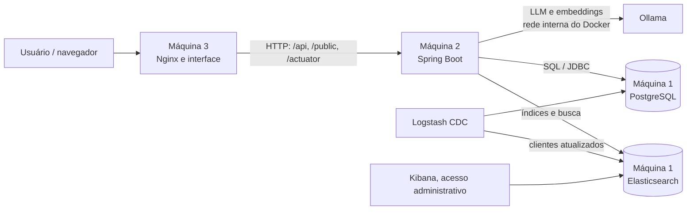

# AlEx AI Platform

Plataforma modular para publicação e gestão de páginas, busca semântica com RAG,
agentes assistivos e operações de entrega para restaurantes. O sistema separa
interface, regras de negócio, persistência e serviços de IA em três máquinas
lógicas independentes, que podem ser executadas em containers Docker.

O documento [Modelo de Arquitetura do Sistema e Guia de Integração](./Modelo%20de%20Arquitetura%20do%20Sistema%20e%20Guia%20de%20Integra%C3%A7%C3%A3o.pdf)
apresenta a visão técnica complementar de arquitetura e evolução.

## Visão da arquitetura



- **Máquina 1 — dados e busca:** PostgreSQL é a fonte da verdade; Elasticsearch
  atende projeções e buscas; Logstash sincroniza dados de clientes; Kibana
  fornece administração visual.
- **Máquina 2 — API e domínio:** aplicação Java/Spring Boot que autentica
  usuários, aplica autorização e regras de negócio, persiste dados, projeta
  páginas no Elasticsearch e integra os modelos servidos pelo Ollama.
- **Máquina 3 — acesso web:** proxy Nginx leve que encaminha `/api/`, `/public/`
  e `/actuator/` para a Máquina 2. A interface completa estática é servida pelo
  backend; o proxy não acessa diretamente o banco ou o Elasticsearch.

As três máquinas podem ser operadas separadamente. O orquestrador
`subir-tudo.sh` coordena as VMs Multipass de teste, descobre seus endereços
atuais e inicia a Máquina 2 depois de validar a infraestrutura de dados. A
Máquina 3 não faz parte desse ambiente Multipass documentado.

## Componentes e tecnologias

| Componente | Tecnologias | Responsabilidade |
|---|---|---|
| Persistência | PostgreSQL 16, Flyway, Spring Data JPA | Dados relacionais e migrações do backend |
| Busca | Elasticsearch 8.15, Kibana | Índices e projeção de páginas, busca e suporte a vetores |
| Sincronização | Logstash com JDBC | CDC por polling dos registros de clientes atualizados |
| Backend | Java 25, Spring Boot 3.5, REST, Actuator | API, autenticação, autorização e regras do domínio |
| IA local | Ollama, Qwen 2.5 3B e `nomic-embed-text` | Geração de texto e embeddings para busca/RAG |
| Frontend/proxy | Nginx 1.27 Alpine | Landing simples e encaminhamento HTTP ao backend |
| Infraestrutura | Docker Compose e Multipass | Execução isolada e orquestração do ambiente de teste |

## Capacidades implementadas

- Login baseado em identidade Google verificada e emissão de JWT próprio com
  validade de oito horas; a lista de administradores é configurada por ambiente.
- Páginas com controle de proprietário, leitura pública, projeção para
  Elasticsearch e reconstrução dessa projeção.
- Busca/RAG e chat assistivo com os modelos configurados no Ollama. A
  disponibilidade da IA não deve ser usada para autorizar ou calcular operações
  financeiras.
- Gestão administrativa de usuários, solicitações de acesso, agentes
  customizados e clientes.
- Entrega própria por loja: configuração de taxa e raio, cotação, validação de
  cobertura e pedido com verificações de propriedade e suporte a idempotência.
- Health checks e operações administrativas para as stacks de dados e backend.

### Escopo e evolução da arquitetura

O PDF também descreve uma visão de evolução com hub de múltiplos provedores (como iFood,
Uber Direct, Keeta e 99), circuit breaker, fluxos CrewAI e ferramentas MCP
somente leitura. Esses itens são objetivos arquiteturais descritos no documento,
não devem ser entendidos como integrações já disponíveis no código atual. A
implementação de entrega identificada no backend é a modalidade de **entrega
própria**; confirme o estado de cada integração no código antes de planejar seu
uso em produção.

Da mesma forma, qualquer cálculo de preço, frete ou total deve permanecer
determinístico no backend. Modelos de IA são consultivos e não aprovam
pagamentos nem alteram valores.

## Fluxo de dados

1. O navegador acessa o Nginx da Máquina 3, que encaminha as rotas de API e de
   conteúdo público para a Máquina 2.
2. O backend valida a identidade e o papel do usuário antes de executar
   operações protegidas. A persistência relacional é feita no PostgreSQL.
3. Páginas são projetadas no Elasticsearch para leitura e busca. O Logstash
   consulta mudanças de clientes no PostgreSQL periodicamente e atualiza o
   índice correspondente.
4. Quando necessário, o backend consulta o Ollama em sua rede interna para
   geração de texto ou embeddings; o acesso à base de dados continua sob
   responsabilidade da aplicação.

## Modelo de dados e índices

O schema inicial do PostgreSQL inclui páginas, usuários, solicitações de acesso,
agentes customizados e clientes. Migrações Flyway do backend acrescentam as
estruturas de configuração de entrega, pedidos e itens de pedido. O PostgreSQL
é a fonte autoritativa; Elasticsearch mantém índices de leitura, incluindo
`public_pages` e `clientes`. Não trate o índice de busca como substituto do banco
relacional.

## Executar o ambiente de teste

### Requisitos

- Docker Engine 24 ou superior e o plugin `docker compose`.
- Para o ambiente coordenado: Multipass disponível no host.
- Memória para os containers. Elasticsearch usa heap configurado de 512 MB; o
  Ollama executa em CPU nas VMs Multipass sem GPU passthrough.

### Subida coordenada

No host que administra as VMs:

```bash
./subir-tudo.sh up
```

O script prepara as VMs e o Docker quando necessário, configura a conectividade
entre as máquinas e aguarda os serviços de dados antes de subir o backend.
Consulte a documentação de cada máquina para opções, pré-requisitos, comandos
administrativos e resolução de problemas.

### Subida por componente

Configure os arquivos de ambiente locais a partir dos exemplos, sem versionar
segredos:

```bash
cd maquina1-dados
cp .env.example .env
# Edite .env e defina senhas fortes antes da primeira subida.
./start.sh
```

Depois, configure os endereços e credenciais da Máquina 1 na Máquina 2:

```bash
cd ../maquina2-backend
cp .env.example .env
# Edite .env com os endereços atuais e os segredos correspondentes.
./start.sh
```

Por fim, configure o proxy da Máquina 3 para apontar para a API:

```bash
cd ../maquina3-frontend
cp .env.proxy.example .env.proxy
# Edite BACKEND_URL para usar o endereço atual da Máquina 2.
./start.sh
```

Os comandos devem ser executados a partir dos diretórios indicados. Se os
serviços forem executados em hosts distintos, ajuste os endereços de bind e
firewall conforme os guias individuais. Os exemplos locais usam `127.0.0.1`
como bind padrão; o orquestrador configura a rede de teste.

### Modelos de IA

O backend usa `qwen2.5:3b` para geração e `nomic-embed-text` para embeddings por
padrão. A inicialização pode baixar e aquecer os modelos automaticamente; em
ambiente isolado, eles também podem ser baixados pelo container Ollama:

```bash
docker exec -it ollama_cuda ollama pull qwen2.5:3b
docker exec -it ollama_cuda ollama pull nomic-embed-text
```

O uso de GPU requer configuração adicional do host, do NVIDIA Container Toolkit
e do Compose. As VMs Multipass documentadas executam o Ollama em CPU.

## Verificações

- Health da API: `GET /api/health` na Máquina 2.
- Health do proxy: `GET /healthz` na Máquina 3.
- Health do Elasticsearch: endpoint `/_cluster/health` com autenticação.
- Health do PostgreSQL: `pg_isready` ou o health check do Compose.

Endpoints administrativos de saúde e observabilidade devem continuar restritos
à rede e às políticas configuradas para o ambiente.

## Segurança e operação

- **Não versione segredos.** Preencha `.env` localmente a partir de
  `.env.example`; não copie senhas, chaves JWT, tokens, sessões ou credenciais
  para documentação, issues, logs compartilhados ou imagens.
- Use senhas fortes e distintas para PostgreSQL, Elasticsearch, Logstash e JWT.
  Configure `ADMIN_EMAILS`, `GOOGLE_CLIENT_ID` e as origens permitidas de acordo
  com o ambiente.
- Mantenha PostgreSQL e Elasticsearch acessíveis somente aos serviços e hosts
  necessários. O firewall da Máquina 1 restringe essas portas no ambiente
  Multipass.
- O chat público de páginas não exige login por decisão de produto. Antes de
  expô-lo à Internet, implemente controles contra abuso, configure domínio,
  HTTPS/TLS e revise as políticas de segurança.
- O ambiente Multipass é de teste, não uma configuração pronta para produção.
  Não exponha diretamente as portas 5432, 9200 ou 8080 à Internet.
- `docker compose down` preserva os volumes; `docker compose down -v` apaga os
  dados persistidos. Use este último somente quando a remoção dos dados for
  intencional.

## Estrutura do repositório

```text
.
├── maquina1-dados/       # PostgreSQL, Elasticsearch, Kibana e Logstash
├── maquina2-backend/     # API Spring Boot, Ollama e configuração de runtime
├── maquina3-frontend/    # Nginx proxy e configuração do frontend
├── subir-tudo.sh         # orquestração do ambiente Multipass
└── Modelo de Arquitetura do Sistema e Guia de Integração.pdf
```

Cada diretório de máquina possui seu próprio guia de instalação e operação. O
PDF de arquitetura complementa este resumo; o código e os guias operacionais
devem ser usados para confirmar o comportamento efetivamente disponível.
